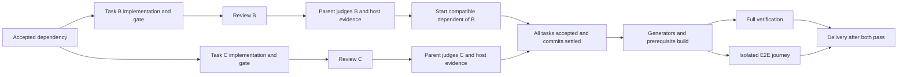

# e2e-feature workflow latency investigation

Snapshot: November 7–9, 2026 UTC, local kazuki sessions. This follow-up uses the original audit's 17 orchestrator sessions and 272 child runs. Fourteen sessions have child transcripts usable for interval analysis. It inspects persisted child transcripts, acceptance verification records, parent launch/handoff messages, surviving task briefs, and the installed pi-subagents v0.84.0 implementation.

This is a retrospective diagnosis, not a benchmark of the changed workflow. Summed durations across overlapping agents or sessions are not end-to-end latency. Human approval, external dependencies, parent-run commands, and later follow-up work occur inside session spans. No fixed percentage improvement is supported.

## Findings

| Bottleneck | Observed evidence | Change |
| --- | --- | --- |
| Review model processing | 92 reviewer runs: 295.28 transcript wall minutes, 294.00 recorded model minutes, approximately 0.21 recorded tool minutes | Give exact task contracts, relevant acceptance criteria, interface/test paths and gate receipts; omit inventories of correct code; retain substantive review and delta-only fix reviews |
| Whole-wave scheduling | Multi-image-caption T4 depends on T1/T2. At 07:06:57 UTC the parent reported T2 reviewed with zero issues and its gate passing, but waited for unrelated T3's review and launched T4 at 07:11:12 | Release compatible dependencies after parent acceptance, before deferred commits or unrelated wave tasks finish |
| Batch implementation barrier | Web Hermes T2 finished its worker at about 22:10:05 UTC, with metadata settlement about four seconds later, but its review began at 22:13:21, together with the slower T3's review | Chain implement → independent gate → review per task, observing all chains together |
| Required-check inventory discovered late | Web Hermes began restoring its original full configured suite at 00:15:49 UTC; final acceptance of the full suite plus coverage was at 00:42:15, another 26m26s | Discover required projects and supported environment up front; preserve full scope, existing baselines and thresholds; smoke the actual browser/container recipe |
| Verification duplication and serialization | 157 recorded host verification executions total 204.32 minutes; some full-suite and coverage invocations execute equivalent tests, and the skill required an additional acceptance rerun after a read-only review | Reuse independently produced receipts only when all relevant input/environment identities match; combine equivalent test/coverage runs; group locks by actual resource conflicts |
| Full verification followed by E2E | Web Hermes finished its first full-verification reconciliation at about 23:35:58 UTC before starting the isolated journey; journey failures then required additional fixture repairs | Permit final verification and E2E to overlap on stable inputs and isolated artifacts/resources; both remain required |
| External artifact incompatibility | Android Hermes built a delivered SDK artifact before discovering missing existing Threads Inbox APIs, then rebuilt from corrected SDK delivery | Require old-plus-new API compatibility, exact revision, variant, artifact digest and a durable copied verification report before expensive consumer builds |

The scheduling examples identify opportunities, not replayed savings. T4 has approximately 4m15s between the ready report and launch, but launching early is valid only if source reads, test inputs and resource ownership can safely overlap. Starting T2's review earlier does not necessarily shorten the whole Web Hermes feature because later work may still depend on T3. Similarly, the 26m26s includes necessary tests: an early correct recipe could avoid investigation and repeated testing, but cannot remove required execution.

## A runtime barrier hidden behind the scheduling advice

The installed runtime sends incremental child completion notices, but `incrementalChildCompletionTriggersTurn()` returns false for successful children while their workflow is running. `emit()` only persists data. Consequently, changing a prompt to say “accept finished tasks immediately” would still leave the parent idle until the slowest sibling finished.

The Nix package now carries a focused patch exposing a workflow-only `notifyOnComplete: true` child option. Put it on a task's final review. When that child settles, it requests a native parent turn while siblings continue. Ordinary intermediate successes stay quiet, scheduled quiet-success policy remains effective, and failures retain their existing behavior. The parent still judges the report and validates the host gate before acceptance; no dependency is automatically accepted or launched.

The option is consumed before forwarding the launch contract to the child. It adds no child tools and does not change existing tool definitions or historical prompts. Existing keyed-run reuse does not deliver an extra wake for the same invocation. The package includes five regression checks covering a review finishing while a sibling remains blocked, the quiet intermediate completion, quiet scheduling and actionable failures, invalid policy values, rejected launch-only receipts, and keyed-run reuse.

Two more implementation constraints appeared during testing: nested async functions are rejected by the installed portable workflow sandbox, and a retained resume cannot accept a new `gate` parameter. Parallel task templates therefore use plain functions returning promise chains, observed by `Promise.all`. The repair template attaches independent host verification to the fresh verification reviewer instead of the resumed worker. The three bundled workflow examples were executed with mock children against the packaged runtime; they launch the expected implementation/review sequence without polling or actual model requests.

## What review timings do and do not imply

Reviewer responses have median duration 10.7s, p90 48.3s and p95 65.6s. Twelve individual responses exceed two minutes, totaling 42.34 model minutes. The longest recorded response took 471.1s and reported 47,901 output tokens, including 45,754 reasoning tokens.

Across reviewers, the provider reports 487,293 reasoning tokens and 682,481 output tokens. Those fields indicate that much of the time is hidden reasoning, not filesystem latency or visible report prose. Shorter visible output alone cannot be assumed to remove that time. The 294 recorded model minutes are only a timing field reported by the provider; they do not separately identify queueing, time to first token, reasoning speed or generation speed.

The skill now uses user-selected Gemini high reasoning and the existing review-round limits. The retrospective timings below were collected before that setting changed. It supplies a narrower, evidence-rich brief, asks for all concrete current findings and a short verdict, allows reading callers/dependencies to substantiate defects, and avoids repeated deterministic artifact audits. Switching reviewer models or reducing reasoning needs a controlled comparison of latency and finding quality on the same task packets; this investigation does not claim such a comparison has happened.

## Interval analysis

Using each child transcript's start and the later of its transcript end or metadata settlement, the analysis unions intervals within each parent session. The summed per-session slices are:

| State within a session's first-to-last child span | Minutes |
| --- | ---: |
| Exactly one worker active | 1,487.38 |
| Exactly one reviewer active | 264.05 |
| Exactly one progress-journey worker active | 58.90 |
| Two or more children active | 143.60 |
| No recorded child active | 546.74 |

These sums combine different sessions, some running simultaneously. “Only a reviewer active” demonstrates frequent serialized review segments; it does not prove independent work was runnable. “No child active” includes parent tools, human decisions and external dependencies, and must not be labeled idle or avoidable. A long waiting child likewise is not evidence of continuous computation.

Host verification durations also include lock acquisition unless separately recorded. A slow `flock ... test` is not proof of a slow test runner. The new run recipe calls for command start, lock acquisition, execution finish and acceptance timestamps when available, with missing measurements left unknown.

## Scheduling after these changes

Waves remain useful presentation metadata. Explicit approved barriers, overlapping file ownership, source reads, mutable generated inputs, shared coverage destinations, browsers and devices still impose real ordering. Commits wait for running workers/reviewers to settle so hooks and a changed HEAD cannot interfere with them. Acceptance itself can release a compatible dependency before its commit is written.

Verification and E2E have serial cost `V + E` and theoretical overlap cost `max(V, E)` only when their inputs/resources are independent. The potential saving is bounded by `min(V, E)` before contention; the transcript does not establish a reliable value for a representative run. Each branch must run against stable feature inputs. Repairs invalidate overlapping evidence, and delivery waits for both branches.

## Implementation and remaining measurement

The execution layer now supports prerequisite check graphs (`needs`), bounded `max_parallel`, named worktree/repository/host resources, and conservative serialization for undeclared commands. Failed prerequisites block their dependents while unrelated checks finish. Generated prerequisite artifacts participate in consumer fingerprints, and directory artifact identities survive receipt serialization. Results record queue/resource/capacity timing and cancellation terminates active command groups.

The runner also provides copied build snapshots with source/environment and artifact validation before/after E2E. Concrete Element Web recipes prepare and pin the build before parallel verification readers, preserve full configured unit/browser/Storybook discovery, retain legacy Jest when present, and use a separate journey browser before allowing browser-test overlap. Android recipes validate existing and new SDK APIs plus AAR ABI/bindings before builds, then preserve the repository's required Gradle-before-emulator ordering.

A six-request, two-snapshot [reviewer pilot](e2e-review-benchmark.md) has also been completed and adjudicated. Faster settings distinguished the known bug from its fixed control, but that sample is insufficient to establish equivalent review quality. The user subsequently selected Gemini high as the reviewer default; high reasoning was not measured in that pilot. The benchmark is opt-in and never an extra stage of ordinary feature work.

The changes live in:

- `home/modules/programs/pi-coding-agent-skills/e2e-feature/SKILL.md`: dependency-driven launch, task-boundary review wakes, compact reports, independent evidence reuse, early environment smoke, resource-aware locking, focused review briefs and conditional verification/E2E overlap.
- `home/modules/programs/pi-coding-agent-skills/e2e-feature/references/latency.md`: environment/input receipt requirements, portable parallel example, overlap rules, dependency handoff and timing guidance.
- `pkgs/pi-subagents/task-boundary-wake.patch` and `task-boundary-wake.test.mjs`: native opt-in task-completion wake and package regression checks.

This follow-up adds latency changes alongside the token, waiting, and verification-runner work. Building the Nix package does not activate it in existing Pi sessions. The skill and patched runtime must be activated together; a running session needs a reload or restart to adopt the new runtime.

Measure future runs using the existing trace and host receipts: ready-to-launch delay, gate-to-review delay, review-to-dependent-launch delay, lock wait, review model duration, environment repair time, duplicate executions with unchanged inputs, and full verification/E2E overlap. Keep human approval and external producer waits separate. Compare complete feature elapsed time on comparable work before assigning a percentage improvement.

## Reproduction and source evidence

The original snapshot metrics are in `/tmp/e2e-session-audit/audit.json`, produced by `/tmp/e2e-session-audit.py`. The follow-up script is `/tmp/e2e-latency.py`, producing `/tmp/e2e-session-audit/latency.json`. These temporary local artifacts are not committed session data.

Representative source transcripts and task contracts:

- [Web Hermes parent](/home/sinkerine/.pi/agent/sessions/--home-sinkerine-.paseo-worktrees-0w88rorz-lean-parrot--/2026-11-08T21-32-35-320Z_01a1bd13-d278-71f8-90b8-834eee0e133c.jsonl:84).
- [Multi-image-caption T4 dependency contract](/home/sinkerine/dev/element-web/.git/worktrees/venomous-seal/e2e-feature/multi-image-caption/t4-brief.md:22).
- [Multi-image-caption parent](/home/sinkerine/.pi/agent/sessions/--home-sinkerine-.paseo-worktrees-0w88rorz-venomous-seal--/2026-11-09T05-58-24-068Z_01a1bee2-e844-7592-9c3f-a7b15153c561.jsonl:114).
- [Android Hermes parent](/home/sinkerine/.pi/agent/sessions/--home-sinkerine-.paseo-worktrees-3b36k2jo-feat-hermes-slash--/2026-11-09T03-27-27-354Z_01a1be58-b67a-72f0-8888-30d962d87f30.jsonl:120).
